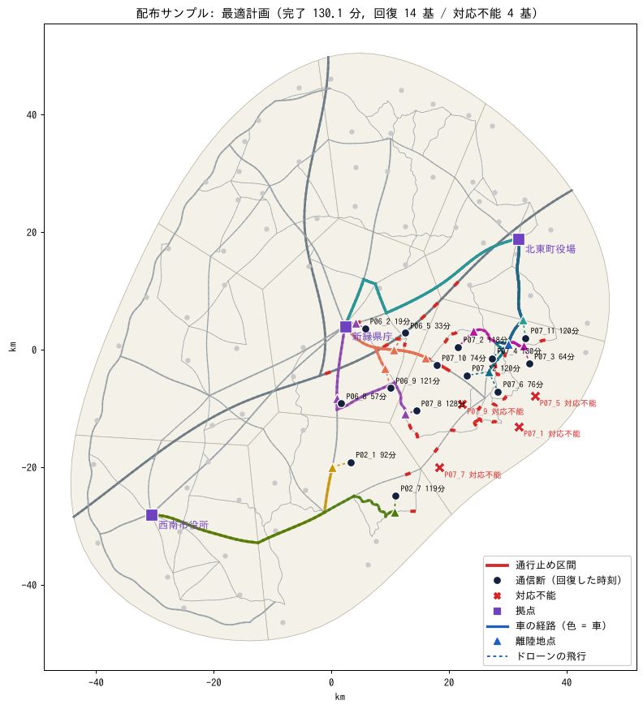
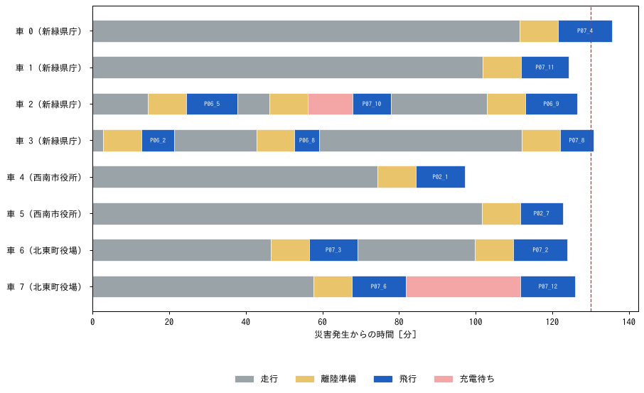

# Phase 2（実データ）: 配布データでの結果

[](https://colab.research.google.com/github/mori560269/Q-Questgrow-/blob/claude/request-5v4fsc/notebooks/phase2_real_colab.ipynb)  Colab で動かす: `notebooks/phase2_real_colab.ipynb`（データの確認・厳密解法・QUBO・Amplify AE（任意）・条件変更・災害の生成）

配布された道路網（`data/phase2_real/roads.geojson` 道路区間 1,682, `road_nodes.geojson` 道路ノード 1,597）と
サンプル災害（`scenario_sample.json`）で Phase 2 を解きました。式は [`FORMULATION_real.md`](FORMULATION_real.md)。

## 条件（シナリオの値をそのまま使用）

- 車 8 台（県庁 4・西南市役所 2・北東町役場 2）, 速さ motorway 60 / link 30 / trunk 40 / primary 30 / secondary 20 km/h
- 停車ごとに離陸準備 10 分. 離陸は一般道（trunk / primary / secondary）だけ
- ドローン: 最大飛行 15 分, 滞空 3 分/基, 40 km/h, 通信半径 0 m → 1 基往復なら半径 4.0 km
- ドック: 充電 30 分, 内蔵 4 回, 予備バッテリー 1 個で +4 回（サンプルは予備 1 個）, 走行中も充電

## 配布サンプルの最適解（`real_run.py`）

- 通信断 18 基のうち **対応不能 4 基（P07_1・P07_5・P07_7・P07_9）** — 課題資料の「4 基は対応不能」と一致。4 基とも 4 km 以内に一般道はあるが, 通行止めでそこへ行けない。
- センサーどうしは最も近くて 2,978 m 離れているため, 2 基以上を回る飛行は 15 分に収まらない（飛行はすべて 1 基ずつ）。
- **最適な完了時刻 130.08 分（厳密解法で証明, 0.2 秒）**。下界（枠割当の最大流）は 126.29 分で差 3%。単純な下界は 87.18 分。
- 平均回復時刻 90.87 分。予備バッテリーは使わない（どの車も 5 回以内）。
- 各センサーの回復時刻 [分]: 52 18.6, 55 32.6, 58 57.5, 62 64.4, 69 74.4, 65 76.2, 10 92.3, 61 118.4, 16 118.7, 70 119.6, 71 120.4, 59 121.2, 67 127.9, 63 130.1




時間の大半は **走行**（secondary 20 km/h と通行止めの迂回）。充電待ちは 2 台だけ。

### 条件を 1 つずつ変えたときの最適値（すべて厳密解法で証明）

| 条件 | 値 | 最適な完了時刻 | 平均回復時刻 | 下界 |
|---|---|---|---|---|
| 基準（配布サンプル） |  | 130.1 分 | 90.9 分 | 126.3 分 |
| 予備バッテリーの数 | 0 | 130.1 分 | 90.9 分 | 126.3 分 |
| 予備バッテリーの数 | 2 | 130.1 分 | 90.9 分 | 126.3 分 |
| 予備バッテリーの数 | 3 | 130.1 分 | 90.9 分 | 126.3 分 |
| 離陸準備の時間 [分] | 0 | 120.1 分 | 81.4 分 | 111.0 分 |
| 離陸準備の時間 [分] | 5 | 125.1 分 | 86.9 分 | 116.7 分 |
| 離陸準備の時間 [分] | 20 | 140.1 分 | 104.0 分 | 140.1 分 |
| 充電の時間 [分] | 15 | 120.5 分 | 86.5 分 | 110.5 分 |
| 充電の時間 [分] | 20 | 129.2 分 | 85.4 分 | 112.3 分 |
| 充電の時間 [分] | 45 | 135.7 分 | 95.3 分 | 130.1 分 |
| 車を 2 台足す拠点 | 県庁 | 130.1 分 | 90.9 分 | 126.3 分 |
| 車を 2 台足す拠点 | 西南市役所 | 130.1 分 | 90.9 分 | 126.3 分 |
| 車を 2 台足す拠点 | 北東町役場 | 99.6 分 | 68.7 分 | 87.8 分 |
| 車の速さ（倍） | 1.5 | 101.1 分 | 71.1 分 | 96.3 分 |
| 車の速さ（倍） | 2.0 | 93.7 分 | 61.6 分 | 75.8 分 |
| 高速道路上でも離陸できる | 可 | 130.1 分 | 90.9 分 | 126.3 分 |

- **北東町役場（震源に最も近い拠点）に車を 2 台足すと 30 分早くなる**。県庁・西南市役所に足しても変わらない。
- 予備バッテリーはサンプルでは効かない。離陸準備・充電・車の速さは効く。

## 再現方法

```bash
cd phase2
python real.py                 # サンプルの前処理・下界・生成した災害の例
python real_run.py             # サンプルの最適計画・図
python real_run.py --sens      # 条件を変えた最適値
python real_batch.py ref       # 基準（厳密解法, 51 問）
python real_batch.py equal     # 同じ計算時間の比較（数時間, 再開できる）
python real_batch.py stats
python real_qubo_improve.py    # 列をまとめた QUBO
python real_alloc.py           # 車の分け方
```

## 解き方（`real.py`, `exact.py`, `lns.py`）

| 種類 | 手法 | 中身 |
|---|---|---|
| 古典 | 貪欲法 + 局所探索 / 反復局所探索（ILS） | 合成データ版と同じ（評価器は実データの条件に対応） |
| 古典 | **厳密解法** | 上限 UB 以下の「車ごとの飛行の組」だけを枝刈りしながら列挙し, 集合分割 MILP を二分探索（`FORMULATION_real.md` 5 節） |
| 古典 | LNS-MILP | 4 台ずつ壊して, 部分問題を厳密解法で解き直す |
| QUBO | 時間枠の判定 QUBO | 合成データ版の二分探索 QUBO（下界を枠割当の最大流に強化） |
| QUBO | **列の集合分割 QUBO** | 厳密解法と同じ列・同じ制約を QUBO に（スラック変数つき）. 列挙は古典 |
| QUBO | LNS-QUBO | 部分問題を列の集合分割 QUBO で解き直す |
| 下界 | 枠割当の最大流 | センサーを「車 × 何番目の飛行」の枠に割り当てられるか, を最大流で判定（`FORMULATION_real.md` 4 節） |

## 多数の災害での比較（`real_batch.py`）

実データの道路網の上で, サンプルの傾向（震源から 20 km 以内が通信断, 橋・トンネルほど通行止めになりやすい）に合わせて災害を作りました（`real.make_real_scenario`）。

- A_同等: サンプルと同じ規模（震源 1, 半径 20 km, 通行止め約 34）
- B_大地震: 半径 30 km, 通行止め約 80, 高速道路も閉じやすい
- C_複合: 震源 2 つ, どこか 1 拠点の車が半分, 予備 0〜2 個
- D_広域: 半径 42 km, 通行止め約 130, 予備 2 個
- E_連続大地震: 震源 2 つ（半径 32 km）, 通行止め約 180, 車が減る, 予備 1〜2 個

### 基準（厳密解法 最大 300 秒 + 下界）

| 系統 | 問題 | 通信断（平均） | 回復可能 | 対応不能 | 通行止め | 全基回復が不可能 | 最適を証明 | 最良と下界の差 | 厳密解法の時間（中央値） |
|---|---|---|---|---|---|---|---|---|---|
| A_同等 | 10 | 14.2 | 12.2 | 2.0 | 34.5 | 0 | 10 | +5.82% | 10.1 秒 |
| B_大地震 | 10 | 25.3 | 19.0 | 6.3 | 73.1 | 0 | 9 | +13.4% | 10.7 秒 |
| C_複合 | 10 | 22.0 | 18.0 | 4.0 | 70.5 | 0 | 8 | +27.56% | 11.5 秒 |
| D_広域 | 10 | 37.0 | 29.9 | 7.1 | 128.6 | 1 | 3 | +46.14% | 192.1 秒 |
| E_連続大地震 | 10 | 47.0 | 32.9 | 14.1 | 178.0 | 3 | 3 | +47.46% | 191.8 秒 |
| サンプル | 1 | 18.0 | 14.0 | 4.0 | 34.0 | 0 | 1 | +3.0% | 10.3 秒 |
| 全体 | 51 | 28.9 | 22.2 | 6.6 | 95.7 | 4 | 34 | +25.92% | 12.7 秒 |

- **サンプル・A・B・C の 31 問中 28 問で最適を証明（中央値 10 秒, その大半は初期解の ILS 10 秒）**。
- D・E は列が多すぎて 300 秒では列挙が終わらず, 最適は 20 問中 6 問だけ証明。全基回復が不可能（車と充電回数が足りない）な問題が 4 問。

### 同じ計算時間での比較（全 51 問）

最良 = その問題で全手法・全予算・基準を通して見つかった最良（まず回復数の最大, 次に完了時刻）。
差は最大回復数に届いた試行だけで平均。勝ち負けは「回復数 → 完了時刻」の辞書式で, 反復局所探索（同じ予算・同じ種）と比べた。5 秒は乱数の種 2 つ, 30 秒は 1 つ。

| 予算 | 手法 | 最大回復数に届いた | 最良との差 平均 [95%CI] | 最良と同じ | 反復局所探索に 勝ち/負け/引分 | p | 実時間の最大 |
|---|---|---|---|---|---|---|---|
| 5 秒 | 古典: 貪欲法 + 局所探索 | 96% | +16.99% [11.57, 22.64] | 20% | 3/31/17 | <0.001 | 9.2 秒 |
| 5 秒 | 古典: 反復局所探索 | 95% | +8.49% [5.15, 12.08] | 50% | 基準 | — | 7.2 秒 |
| 5 秒 | 古典: 厳密解法（列挙 + MILP, 時間内） | 84% | +10.14% [6.17, 14.37] | 59% | 14/48/40 | <0.001 | 4.1 秒 |
| 5 秒 | 古典: LNS（部分問題を列の MILP） | 86% | +8.82% [5.35, 12.87] | 56% | 14/44/44 | <0.001 | 5.1 秒 |
| 5 秒 | QUBO: 時間枠の判定 QUBO（生の解） | 86% | +44.54% [34.62, 54.91] | 26% | 16/67/19 | <0.001 | 7.2 秒 |
| 5 秒 | QUBO: 列の集合分割 QUBO（生の解, 列挙は古典） | 29% | +0.36% [0.09, 0.73] | 73% | 8/76/18 | <0.001 | 14.7 秒 |
| 5 秒 | QUBO: LNS（部分問題を列の QUBO） | 86% | +9.1% [5.66, 12.97] | 49% | 7/47/48 | <0.001 | 6.1 秒 |
| 30 秒 | 古典: 貪欲法 + 局所探索 | 96% | +16.58% [11.15, 22.29] | 20% | 0/38/13 | <0.001 | 9.1 秒 |
| 30 秒 | 古典: 反復局所探索 | 96% | +0.9% [0.33, 1.64] | 77% | 基準 | — | 30.1 秒 |
| 30 秒 | 古典: 厳密解法（列挙 + MILP, 時間内） | 87% | +6.12% [2.22, 11.08] | 74% | 9/18/27 | 0.122 | 19.9 秒 |
| 30 秒 | 古典: LNS（部分問題を列の MILP） | 96% | +3.15% [1.30, 5.53] | 76% | 9/9/35 | 1.000 | 30.1 秒 |
| 30 秒 | QUBO: 時間枠の判定 QUBO（生の解） | 89% | +34.34% [21.54, 46.42] | 32% | 9/34/10 | <0.001 | 32.6 秒 |
| 30 秒 | QUBO: 列の集合分割 QUBO（生の解, 列挙は古典） | 32% | +0.33% [0.02, 0.88] | 76% | 4/38/11 | <0.001 | 100.7 秒 |
| 30 秒 | QUBO: LNS（部分問題を列の QUBO） | 96% | +3.6% [1.67, 5.98] | 61% | 3/12/38 | 0.035 | 31.9 秒 |

系統ごと（30 秒, 最良との差の平均 と 最大回復数に届いた割合）:

| 系統 | 貪欲+LS | ILS | 厳密（時間内） | LNS-MILP | 時間枠 QUBO | 列 QUBO | LNS-QUBO |
|---|---|---|---|---|---|---|---|
| サンプル | +11.1%（100%） | +4.45%（100%） | +0.0%（100%） | +0.0%（100%） | +0.0%（100%） | +2.35%（100%） | +4.45%（100%） |
| A_同等 | +5.63%（100%） | +1.5%（100%） | +0.0%（100%） | +0.0%（100%） | +0.65%（100%） | +0.08%（91%） | +0.0%（100%） |
| B_大地震 | +7.61%（100%） | +0.31%（100%） | +3.03%（100%） | +0.93%（100%） | +24.69%（100%） | +0.0%（10%） | +1.55%（100%） |
| C_複合 | +7.32%（100%） | +1.22%（100%） | +3.81%（100%） | +0.22%（100%） | +47.75%（100%） | +0.0%（40%） | +0.29%（100%） |
| D_広域 | +31.72%（90%） | +0.5%（90%） | +5.43%（60%） | +5.97%（90%） | +65.08%（80%） | —（0%） | +6.48%（90%） |
| E_連続大地震 | +34.45%（90%） | +0.0%（90%） | +26.68%（70%） | +10.61%（90%） | +60.34%（60%） | —（0%） | +10.89%（90%） |

## QUBO の改良: 離陸地点が違うだけの列をまとめる（`real_qubo_improve.py`）

同じ拠点・同じセンサーの組の列は, 完了時刻が最短のものだけ残しても最適値は変わらない（`exact.reduce_columns`）。
QUBO の変数が減るので, 焼きなましが解きやすくなるかを確かめた。各問題で反復局所探索 5 秒の解を上限に列を列挙し（古典の前処理, 共通）,
同じ列を MILP（最適を証明）と QUBO（30 秒, CPU の焼きなまし）で解いた。全基回復できる 35 問で集計（D・E の最大級 5 問は列挙が終わらず打ち切り）。

| | QUBO の解が出た | 最適と同じ | 列（中央値） | QUBO の最大変数（中央値） | MILP の時間（中央値, 列挙込み） |
|---|---|---|---|---|---|
| 全部の列 | 14 / 35 | 14 | 693 | 358 | 0.59 秒 |
| まとめた列 | 19 / 35 | 15 | 140 | 104 | 0.43 秒 |

列の数ごと:

| 列の数 | 列 | 問題 | QUBO の解が出た | 最適と同じ |
|---|---|---|---|---|
| 0〜100 | 全部 | 2 | 2 | 2 |
| 0〜100 | まとめた後 | 15 | 14 | 14 |
| 100〜300 | 全部 | 11 | 9 | 9 |
| 100〜300 | まとめた後 | 8 | 4 | 1 |
| 300〜1000 | 全部 | 7 | 3 | 3 |
| 300〜1000 | まとめた後 | 8 | 1 | 0 |
| 1000〜 | 全部 | 15 | 0 | 0 |
| 1000〜 | まとめた後 | 4 | 0 | 0 |

- まとめると列が約 1/5 になり, QUBO で解ける問題が 14 → 19 に増えた。
- **成否を決めるのは列（変数）の数**: 100 未満なら 15 問中 14 問で最適, 100〜300 で半分, 300 を超えるとほぼ解けない。
- 同じ列なら MILP は 1 秒以内で最適を証明する。QUBO（CPU の焼きなまし）が MILP に並ぶのは列 100 未満の小さい問題だけ。

## 平常時の計画: 8 台を 3 拠点にどう分けるか（`real_alloc.py`）

各拠点 1 台以上・合計 8 台の分け方 21 通りすべてで, 同じ災害 21 問（配布サンプル + A_同等 10 + B_大地震 10）を
厳密解法（最大 60 秒）で解いた。441 回中 415 回は最適を証明（残り 26 回は時間切れの最良解）。

| 順位 | 県庁 | 西南市役所 | 北東町役場 | 完了時刻の平均 | 最悪 | 平均回復時刻の平均 |
|---|---|---|---|---|---|---|
| 1 | 5 | 1 | 2 | 148.92 分 | 304.33 分 | 101.39 分 |
| 2 | 4 | 2 | 2 | 149.19 分 ← 現状 | 321.46 分 | 101.01 分 |
| 3 | 4 | 1 | 3 | 149.39 分 | 285.02 分 | 103.4 分 |
| 4 | 3 | 3 | 2 | 151.39 分 | 312.69 分 | 106.43 分 |
| 5 | 6 | 1 | 1 | 152.7 分 | 352.26 分 | 103.59 分 |
| 6 | 3 | 2 | 3 | 152.89 分 | 327.06 分 | 104.22 分 |
| 7 | 5 | 2 | 1 | 153.25 分 | 372.8 分 | 103.64 分 |
| 8 | 4 | 3 | 1 | 154.64 分 | 372.8 分 | 105.12 分 |
| 20 | 1 | 6 | 1 | 179.37 分 | 361.58 分 | 126.43 分 |
| 21 | 1 | 1 | 6 | 193.4 分 | 401.6 分 | 127.65 分 |

- **現状の 4・2・2 は平均でほぼ最良**（1 位の 5・1・2 と 0.3 分差）。
- 最悪の災害に備えるなら **4・1・3**（北東町役場に 1 台移す）: 平均はほぼ同じで, 最悪が 321 → 285 分。
- 1 拠点に偏らせる（1・1・6 など）と平均で 40 分以上遅くなる。

## わかったこと

1. **サンプル規模（A）なら厳密解法で最適が数秒で求まる**。列が数百個までなら, 枝刈りした列挙 + 集合分割 MILP が最も確実。
2. **大規模（D・E）では古典の反復局所探索が最良**。厳密解法は時間内に列挙が終わらず, 途中の解は弱い。
3. **列の集合分割 QUBO は, 解が出れば最適に近い（差 +0.3%）が, 解が出るのは 3 割**。列が数百個を超えると, 焼きなましが制約を満たす解を見つけられない（同じ列を MILP なら 1 秒以内で解く）。
4. 時間枠の判定 QUBO は, 実データでは最良との差 +34%（30 秒）。
5. **QUBO を活かすなら LNS の部分問題**（数十〜数百変数）。LNS-QUBO は LNS-MILP とほぼ同じ質（+3.6% と +3.2%）で, 全体を QUBO で解くより大幅に良い。ただし反復局所探索（+0.9%）には届かない。
6. 計画（平常時）に返すなら, **どの拠点に車を置くか** が効く（サンプルで北東町役場に 2 台足すと −30 分）。8 台の分け方は現状の 4・2・2 が平均でほぼ最良, 最悪に備えるなら 4・1・3。
7. 列の集合分割 QUBO は **列（変数）100 未満なら焼きなましでも最適**。離陸地点が違うだけの列をまとめると, 解ける問題が増える（14 → 19 / 35）。

すべての QUBO の結果は CPU の焼きなまし（neal）。この環境から Amplify AE には接続できないため, Amplify で解き直すと結果が変わる可能性がある（`FORMULATION_real.md` 9 節に Amplify での書き方）。
