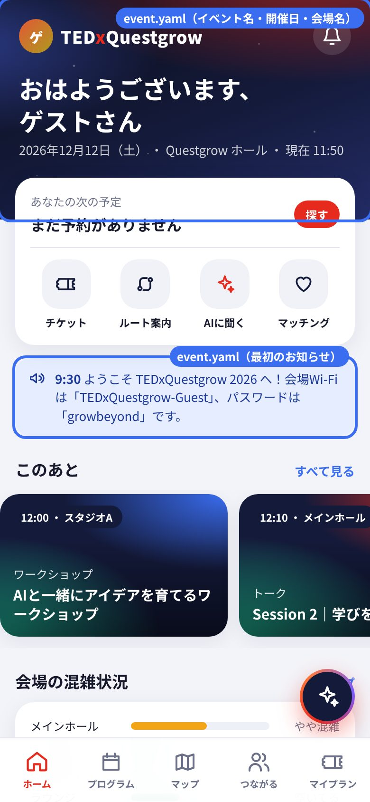
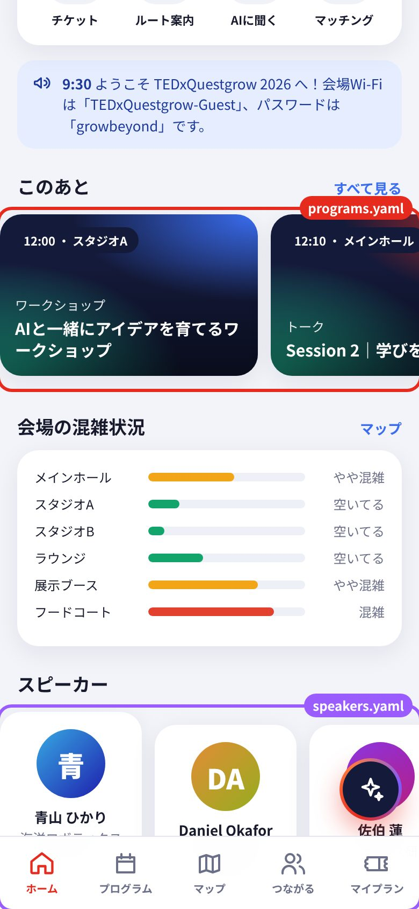
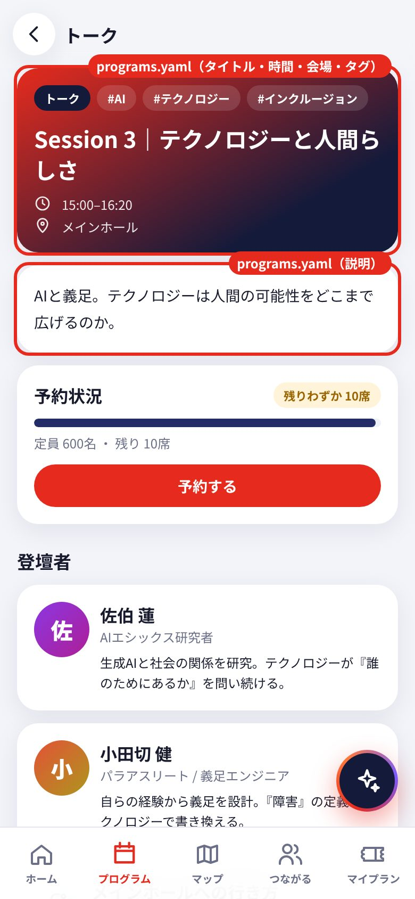
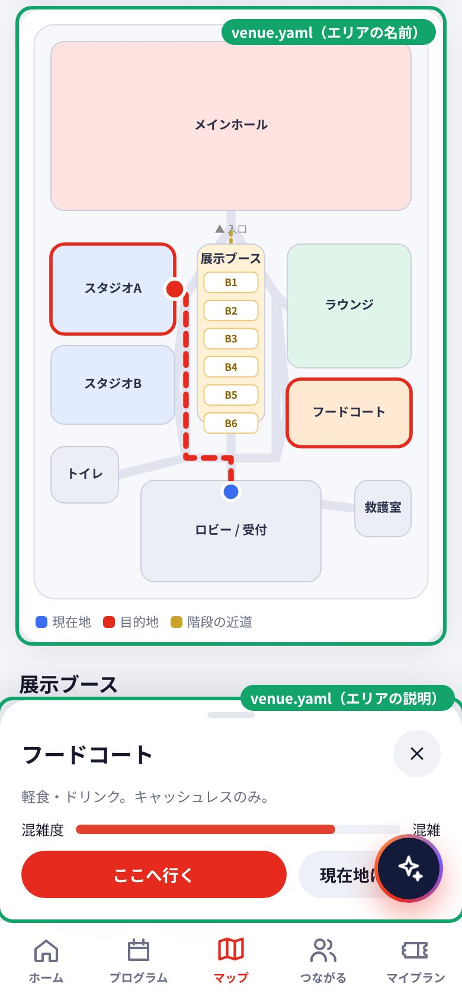
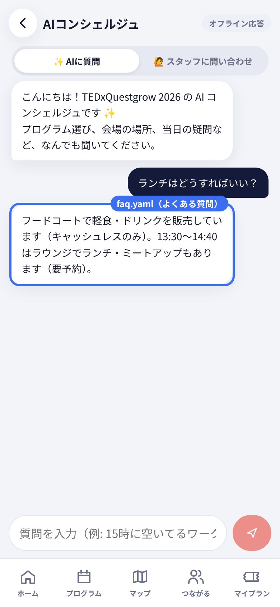
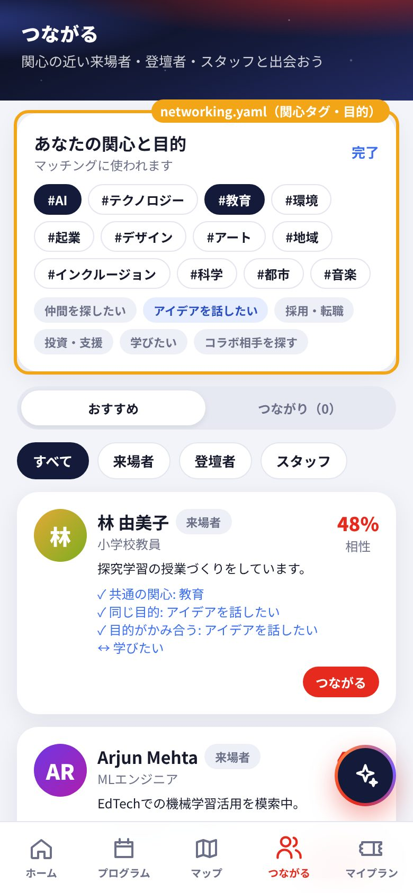

# 掲載情報の編集ガイド

アプリに載せる文章や時間は、すべてこの **`content` フォルダ** の中にあります。
ここにあるファイルを書き換えれば、アプリの表示と AI コンシェルジュの回答が変わります。
プログラミングの知識はいりません。

> **このフォルダの外にあるファイルは触らないでください。** 壊れたときに直すのが大変です。

---

## 1. 変えたいものと、開くファイル

| 変えたいもの | 開くファイル |
|---|---|
| イベント名、テーマ、開催日、会場名、開場・閉場の時刻、Wi-Fi、最初のお知らせ | [`event.yaml`](event.yaml) |
| プログラム（タイトル・時間・会場・定員・予約の要不要・説明・タグ） | [`programs.yaml`](programs.yaml) |
| 登壇者（名前・肩書き・プロフィール） | [`speakers.yaml`](speakers.yaml) |
| マップのエリア名とその説明、展示ブース B1〜B6 の名前 | [`venue.yaml`](venue.yaml) |
| AI コンシェルジュが答える「よくある質問」 | [`faq.yaml`](faq.yaml) |
| 「つながる」で選べる関心タグと目的 | [`networking.yaml`](networking.yaml) |

### 画面のどこがどのファイルか

<table>
<tr>
<td align="center"><br>ホーム上部 → <code>event.yaml</code></td>
<td align="center"><br>ホーム下部 → <code>programs.yaml</code> / <code>speakers.yaml</code></td>
<td align="center"><br>プログラム詳細 → <code>programs.yaml</code></td>
</tr>
<tr>
<td align="center"><br>マップ → <code>venue.yaml</code></td>
<td align="center"><br>AI の回答 → <code>faq.yaml</code></td>
<td align="center"><br>つながる → <code>networking.yaml</code></td>
</tr>
</table>

### ファイルではなく「運営画面」で変えるもの

次のものは、イベント当日にアプリの **運営ダッシュボード**（プロフィール → 「運営スタッフ」→ 下のタブの「運営」）から変えます。ファイルを書き換える必要はありません。

- 当日のお知らせの配信
- プログラムの遅延・中止
- エリアの混雑度
- 受付のチェックイン、問い合わせへの返信

---

## 2. 編集のしかた（GitHub のサイト上で、ブラウザだけで）

1. GitHub でこのリポジトリを開き、`tedx-event-app` → `content` の順に開きます。
2. 変えたいファイル（例: `programs.yaml`）をクリックします。
3. 右上の **鉛筆マーク（Edit this file）** を押します。
4. 文字を書き換えます（書き方は次の章）。
5. 右上の **Commit changes...** を押します。
6. 「何を変えたか」を一言書きます（例: `ワークショップの開始時間を14:00に変更`）。
7. **Create a new branch for this commit and start a pull request** を選び、**Propose changes** を押します。
8. 次の画面で **Create pull request** を押します。
9. 1〜2分待つと、ページの下の方に自動チェックの結果が出ます。
   - ✅ 緑のチェック：問題ありません。開発担当にレビューを頼んでください。
   - ❌ 赤のバツ：書き方に間違いがあります。**Details** → 左の **Summary** を押すと、どのファイルの何件目をどう直せばいいかが日本語で書いてあります。プルリクエストの **Files changed** タブにも同じ内容が表示されます。同じ手順でもう一度直してください（同じプルリクエストに追加されます）。

エラーの表示は、たとえばこうなります。

```
❌ 掲載情報（content フォルダ）に 2 か所、直してほしいところがあります：

  ・programs.yaml の 2件目（ID: s2）: 「開始」は "10:20" のように書いてください（今は「10時20分」）。
  ・programs.yaml の 2件目（ID: s2）: 登壇者「青山ひかり」が speakers.yaml にいません。名前の表記（スペースなど）をそろえてください。
```

---

## 3. 書き方のルール（3つだけ）

ファイルは「YAML（ヤムル）」という書き方です。`項目名: 中身` の形で書きます。

```yaml
  - ID: w1
    タイトル: AIと一緒にアイデアを育てるワークショップ
    開始: "12:00"
    終了: "13:20"
    登壇者: [佐伯 蓮]
```

1. **行頭のスペース（字下げ）をそろえる。** 上の行と同じ位置から書き始めます。タブキーは使えないので、スペースで字下げします。
2. **`:` の後ろには半角スペースを1つ入れる。** `タイトル:AI` ではなく `タイトル: AI` と書きます。
3. **時刻はダブルクォートで囲む。** `"10:20"` のように書きます。

そのほかのコツです。

- `#` から行末まではメモ（コメント）です。アプリには表示されません。
- 複数のものは `[音楽, アート]` のように、カッコの中にカンマで区切って書きます。
- 長い説明を複数行で書きたいときは、`説明: |` と書いてから、次の行から1段深く字下げして書きます。
- **追加するとき**は、近くの1件をまるごとコピーして貼り付け、中身を書き換えるのがいちばん安全です。
- 各ファイルの先頭に、そのファイルの項目の説明が書いてあります。

### 注意が必要なところ

| やりたいこと | 注意 |
|---|---|
| 登壇者の名前を変える | `programs.yaml` の「登壇者」も同じ表記に直してください。 |
| エリアの名前を変える | `programs.yaml` の「会場」も同じ表記に直してください。 |
| プログラムの `ID` を変える | 公開後は変えないでください。その回の予約が消えたように見えます。 |
| マップのエリアを増やす・形を変える | ファイルではできません。開発担当に相談してください。 |
| 時間や場所を変える | `faq.yaml` の答えに同じ時刻・場所が書いてあれば、そちらも直してください。AI はその文章をもとに答えます。 |

---

## 4. 自分のパソコンで、画面を見ながら編集する（慣れた人向け）

Node.js 22 以上が入っているパソコンなら、アプリを動かしながら編集できます。ファイルを保存した瞬間に画面に反映されます。

```bash
cd tedx-event-app
npm install
npm run dev
```

ブラウザで http://localhost:5173 を開きます。保存したときに書き方の間違いがあれば、`npm run dev` を実行した画面にエラーが表示されます。

チェックだけをしたいときは、次のコマンドを使います。

```bash
npm run content
```

---

## 5. ここにないもの（開発担当が管理）

- 「つながる」のサンプル参加者、予約数の初期値、当日時刻のデモ設定（デモ用のデータで、本番では使いません）
- アプリのアイコン、ブラウザのタブに出る名前（`index.html` と `public/manifest.webmanifest`）
- マップのエリアの形と通路（`src/data/venueLayout.ts`）
